# Faisalabad exploratory data analysis

The analysis uses the audited 2023-2025 UTC dataset: **26,304 hourly rows** and nine numeric variables. All six required metric groups are covered, including wind direction and precipitation amount. Rain probability has no observed column; the rain-event analysis below prepares that later modelling task.

The [executed notebook](../notebooks/01_faisalabad_eda.ipynb) walks through the analysis with code, plots, and beginner explanations. Its outputs can be read on GitHub without downloading the dataset. This report records the main findings and decisions.

## Data and scope

Weather comes from ERA5 reanalysis through Open-Meteo. AQI, pollutants, and UV come from the Open-Meteo CAMS archive. These are modelled series, not independent Faisalabad station measurements. Coverage and field definitions are in [DATASET.md](DATASET.md).

The input CSV fingerprint is checked against the historical audit before analysis. No source values are changed. Charts use Pakistan time (UTC+5); the underlying dataset still covers a UTC-bounded period. This produces partial local days at the two boundaries. Daily plots exclude those partial days, and monthly rainfall totals exclude incomplete local months. Hourly distribution plots retain all records.

All of 2023-2025 is exploratory data. A later test of generalization needs a separate, uninspected time period. We should not call 2025 an untouched test set after inspecting it here.

## 1. Start with distributions

A distribution describes how values are spread. In a histogram, the x-axis shows intervals of values and the y-axis counts records in each interval. The mean is the arithmetic average; the median is the middle value. They differ when a distribution is uneven or has a long tail.

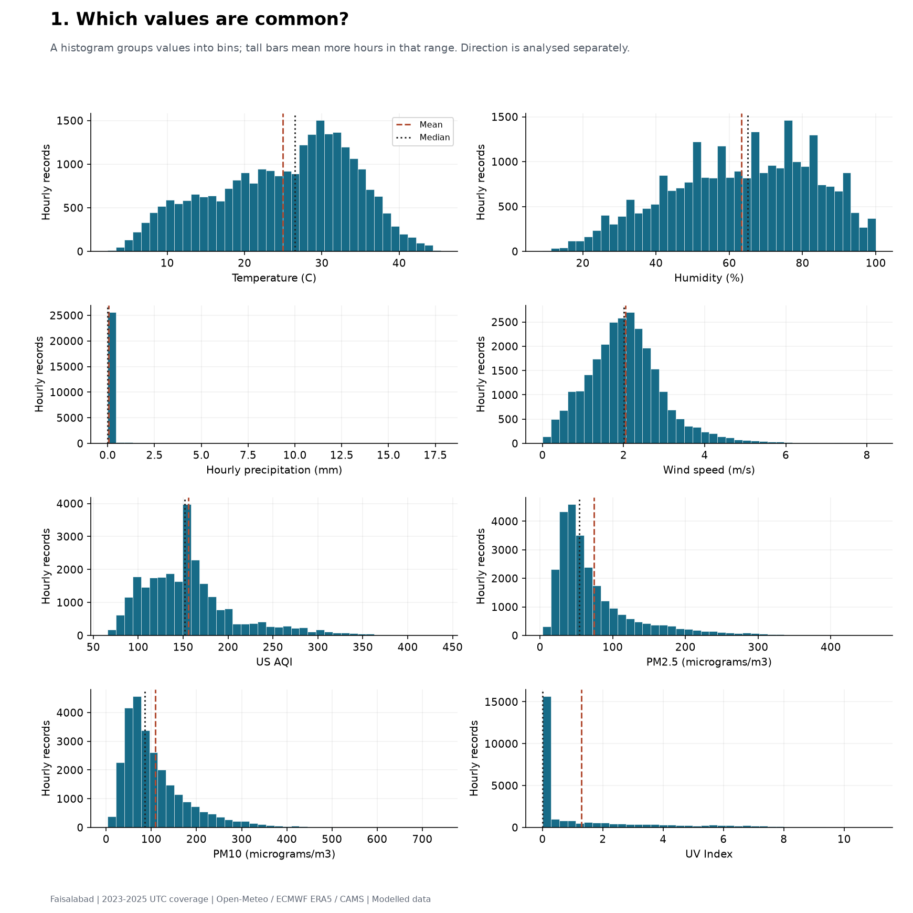

- Temperature spans 2.3 to 45.4 C. One average cannot represent the full seasonal range.
- Rain has a large concentration at zero. Its median is zero, although some hours have substantial rainfall.
- AQI and particulate concentrations have high-value tails. Those extremes matter for hazard forecasting and are not automatically errors.
- UV also has a large zero component. We examine local clock hours before interpreting those zeros.

For a concrete example from this dataset, PM2.5 has a mean of **74.15** and a median of **54.0 micrograms/m3**. The higher mean reflects the influence of the upper tail. Rain has a mean of about **0.0513 mm per hourly interval** and a median of zero; the mean does not describe the amount during a typical wet hour.

Wind direction is excluded from ordinary distribution averages because it is circular. The analysis still keeps its raw values.

## 2. Keep time order and look for seasonality

A time-series plot shows when events occur. Daily averages smooth hourly variation; daily rainfall is summed because it is an accumulated amount. The smoothed chart is only a display, not a replacement for the hourly dataset.

Hazard alerts must use the relevant hourly forecasts and rules. A daily average, especially for UV or AQI, can hide a hazardous peak and must not replace the alert input.

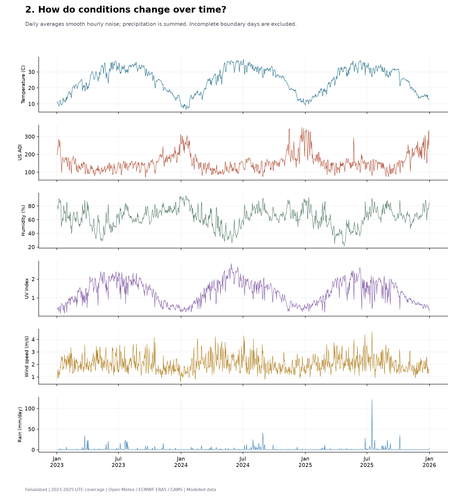

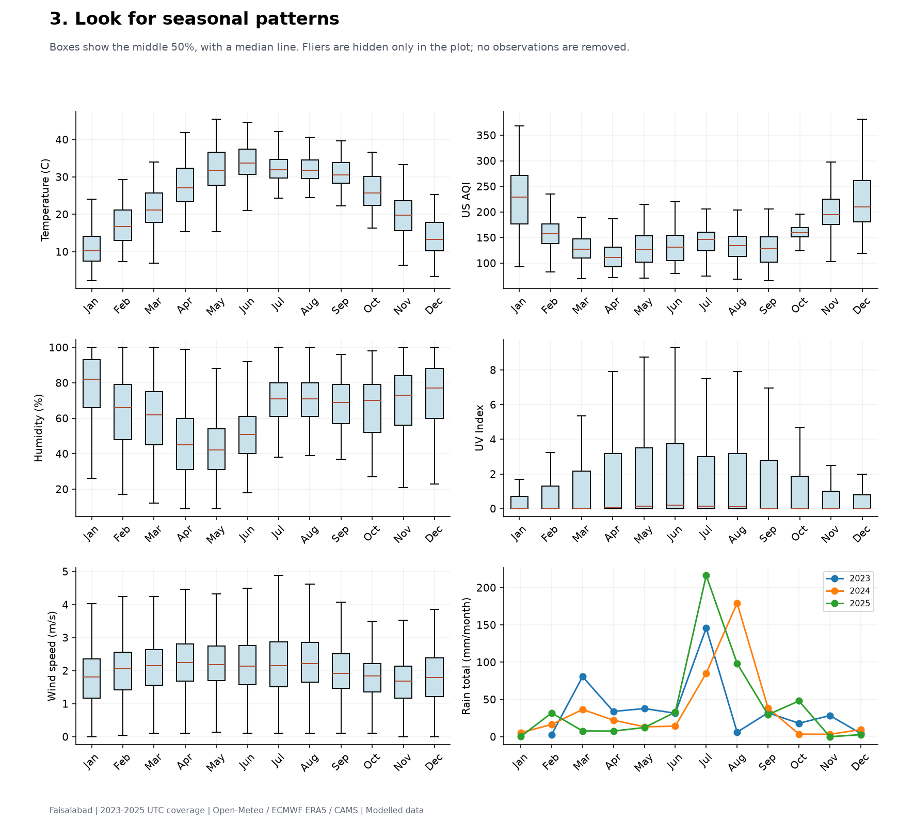

A box spans Q1 to Q3, the middle 50% of observations. Its line marks the median. Whiskers extend to the most extreme observations within the usual 1.5-IQR fences. Outlier points are hidden for readability in these box plots but remain in the dataset.

Pooling the available hourly records by local calendar month gives mean temperature of approximately **11.14 C in January** and **33.86 C in June**. Median AQI is **229 in January**, **111 in April**, and **210 in December**. These are descriptive statistics from the archive, not forecasts or a causal explanation of pollution.

Month-to-month and year-to-year differences support considering seasonal features. Three years are too few to establish long-term climate trends, and archived model changes may also affect comparisons.

## 3. Look within the day

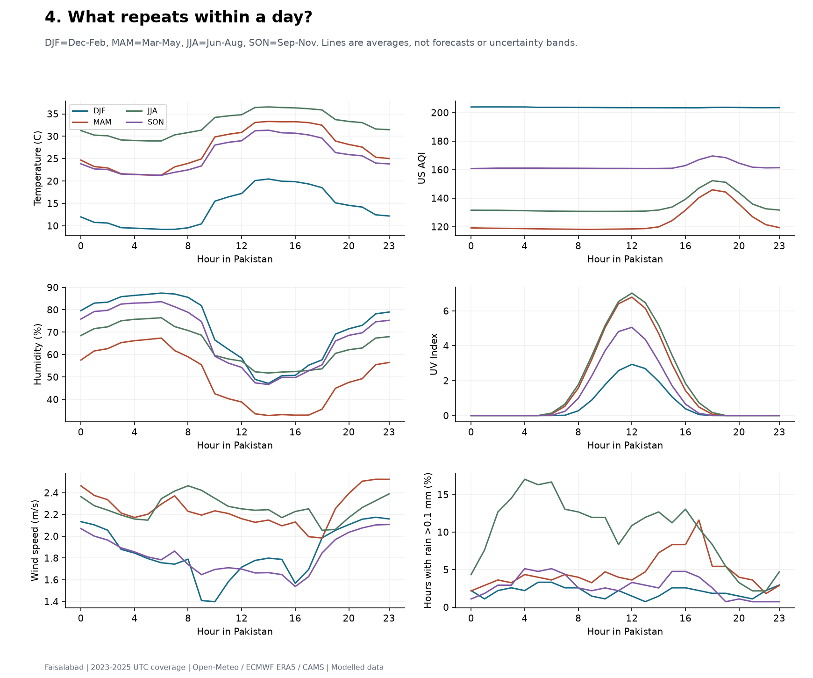

The horizontal axis is local hour. Each seasonal line averages records at that hour. Daily structure is useful evidence for hour-of-day features, but the average line hides individual days and is not an uncertainty band.

UV is zero in **all 4,384 observations between 00:00 and 03:59 local time**. That supports retaining nighttime zeros. This is a simple clock-hour check, not a calculation of solar position. Across all hours, about 52.1% of UV values are zero.

## 4. Separate rain occurrence from amount

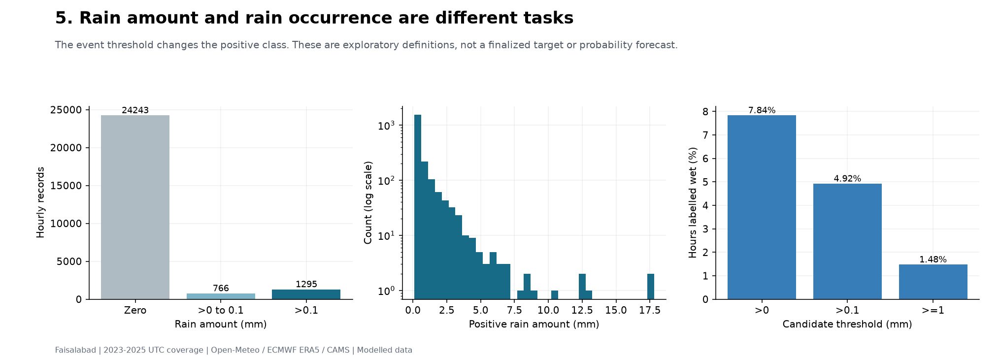

| Exploratory definition of a wet hour | Wet hours | Share of all hours |
| --- | ---: | ---: |
| Amount > 0 mm | 2,061 | 7.84% |
| Amount > 0.1 mm | 1,295 | 4.92% |
| Amount >= 1 mm | 388 | 1.48% |

Exactly **24,243 hours (92.16%)** have zero rainfall. The threshold changes which examples count as wet, so it must be specified before fitting a rain-probability model. None of these thresholds has been finalized as the target definition.

This is class imbalance: the dry class is much larger. With the >0.1 mm definition, an always-dry classifier would score about **95.08% accuracy** while missing every wet hour. Accuracy alone is therefore misleading. Later evaluation should include probability quality and wet-event performance alongside the brief's required forecasting metrics.

Regression estimates amount; classification estimates occurrence. An observed event is a yes/no label. Its probability is something a model estimates, not an observed historical probability value.

The positive-rain histogram uses a logarithmic count axis so rare larger amounts remain visible.

## 5. Respect circular wind direction

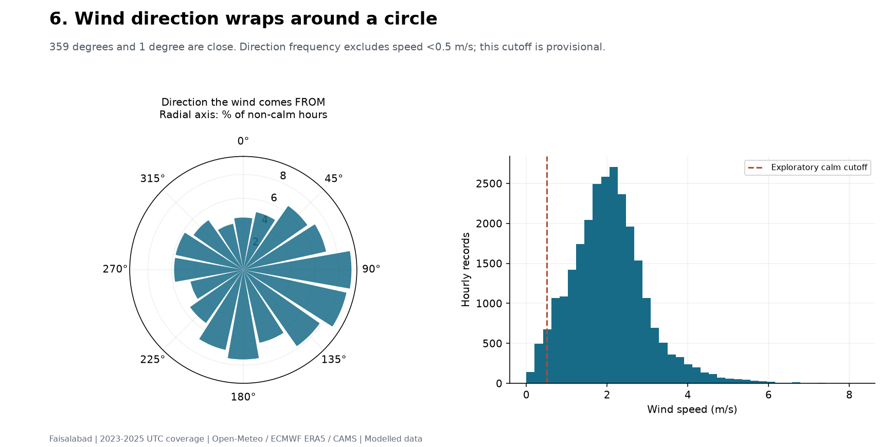

359 degrees and 1 degree are two degrees apart. Their ordinary average, 180 degrees, would point the wrong way. Later feature engineering should use sine/cosine components or wind vectors, and angular errors should wrap around north.

The direction chart counts the direction the wind comes from. It excludes **797 hours** below a provisional 0.5 m/s calm cutoff. That is an EDA convention, not a finalized meteorological alert threshold. The speed histogram retains every hour. Raw 360-degree values remain unchanged; a later circular representation can treat them as 0 degrees.

## 6. Explore relationships without claiming causation

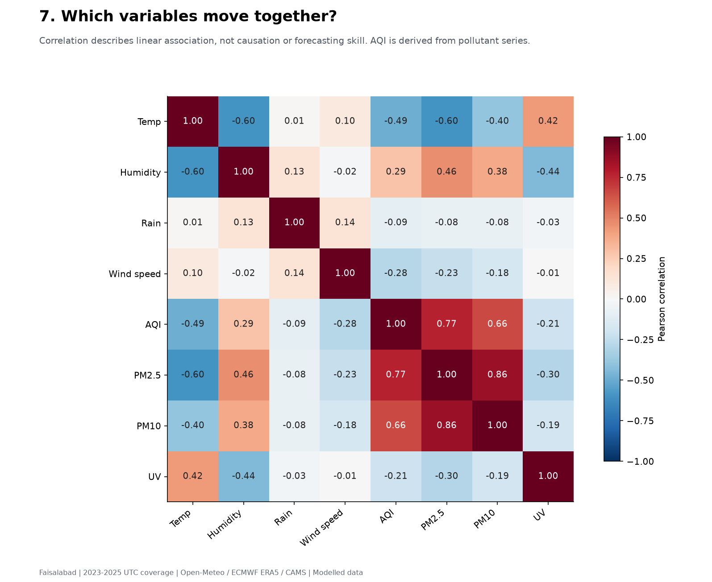

Pearson correlation measures linear association from -1 to +1. Selected relationships with AQI are approximately:

| Other variable | Correlation with AQI |
| --- | ---: |
| PM2.5 | +0.769 |
| PM10 | +0.660 |
| Temperature | -0.490 |
| Humidity | +0.285 |
| Wind speed | -0.281 |

AQI is derived from pollutant series, so its relationship with PM is partly built into its definition. Seasonal patterns can also produce associations. A correlation with temperature does not establish that changing temperature causes AQI to change. Simultaneous correlations do not measure 24-hour forecasting skill.

All sampled PM10 values are at least as high as PM2.5, which passes a basic cross-field consistency check. It does not prove the concentrations are accurate.

Raw wind degrees are excluded from the matrix. No features have been selected solely from these correlations.

## 7. Compare each series with its past

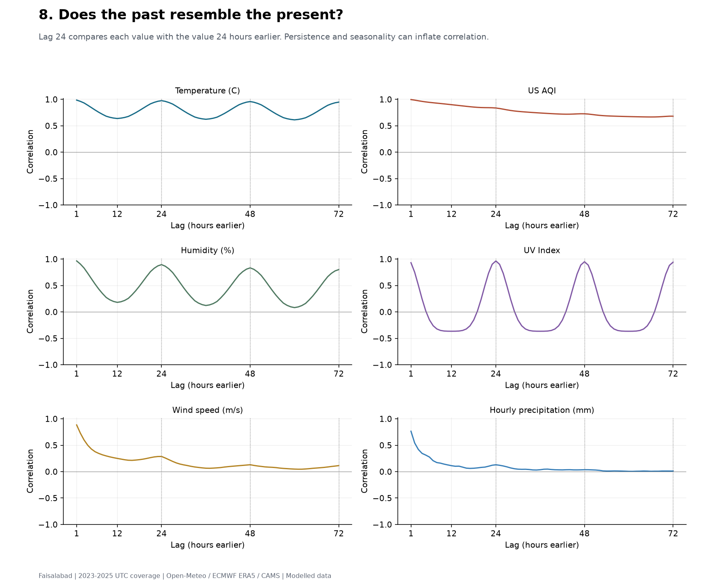

A lag is an earlier time offset. Autocorrelation at lag 24 compares the series with its own values 24 hours earlier.

| Variable | Lag-1 correlation | Lag-24 correlation |
| --- | ---: | ---: |
| Temperature | 0.986 | 0.975 |
| AQI | 0.996 | 0.836 |
| Humidity | 0.965 | 0.894 |
| UV | 0.931 | 0.964 |
| Wind speed | 0.884 | 0.287 |
| Precipitation amount | 0.765 | 0.130 |

Daily repetition is strong for temperature and UV. Wind speed and rain have much weaker lag-24 correlations. This supports evaluating the required daily seasonal naive baseline separately for each output. It does not substitute for calculating its MAE, RMSE, and R-squared.

High autocorrelation also means adjacent observations are dependent. A shuffled split would overstate the independence of training and validation examples. Broad seasonal trends and provider interpolation/smoothing can increase autocorrelation; the plot is not a formal stationarity test.

## 8. Investigate unusual hours in context

### Cooling: 5 June 2024, 17:00 Pakistan time

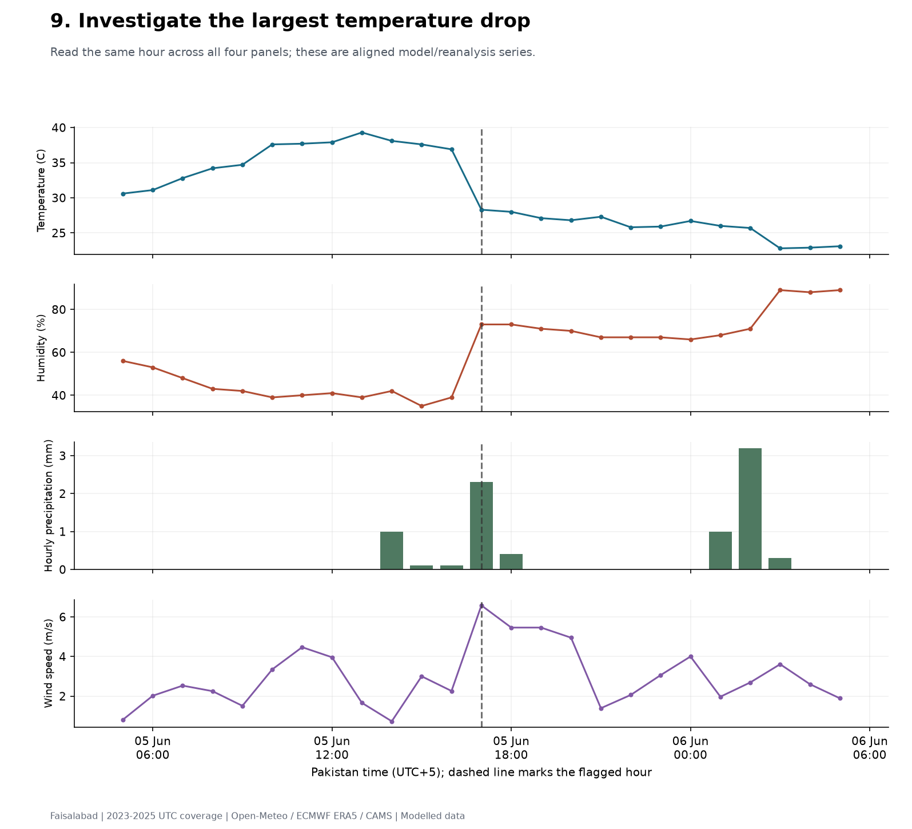

| Variable | Previous hour | Flagged hour |
| --- | ---: | ---: |
| Temperature | 36.9 C | 28.3 C |
| Humidity | 39% | 73% |
| Precipitation | 0.1 mm | 2.3 mm |
| Wind speed | 2.26 m/s | 6.58 m/s |

The 8.6 C cooling coincides with increased humidity, rain, and wind. Together these are consistent with a rain-related cooling event within the reanalysis. We do not have independent evidence proving a storm at the city location. **Retain the event** rather than smoothing it away.

### Warming: 26 January 2025, 10:00 Pakistan time

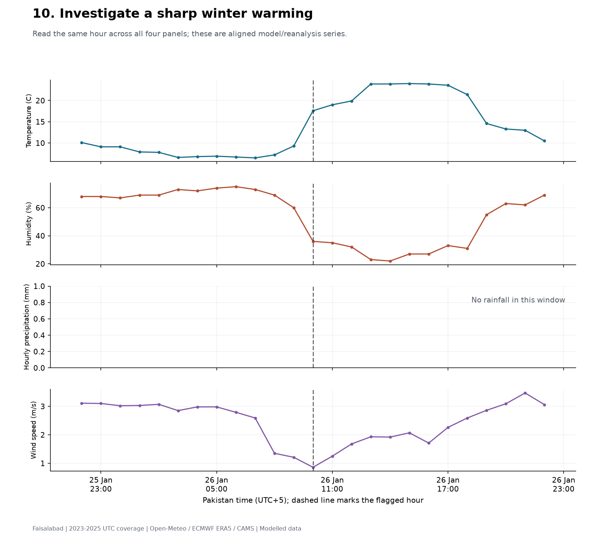

Temperature rises from 9.3 to 17.6 C, humidity falls from 60% to 36%, and the flagged hour has no rain. The surrounding hours continue into warmer, drier daytime conditions. However, this is not an isolated large warming: **226 of 242 changes of at least 6 C occur at 10:00 local time**. Fifteen occur at 19:00 and one at 17:00. The cutoff is exploratory; it is not a rejection threshold.

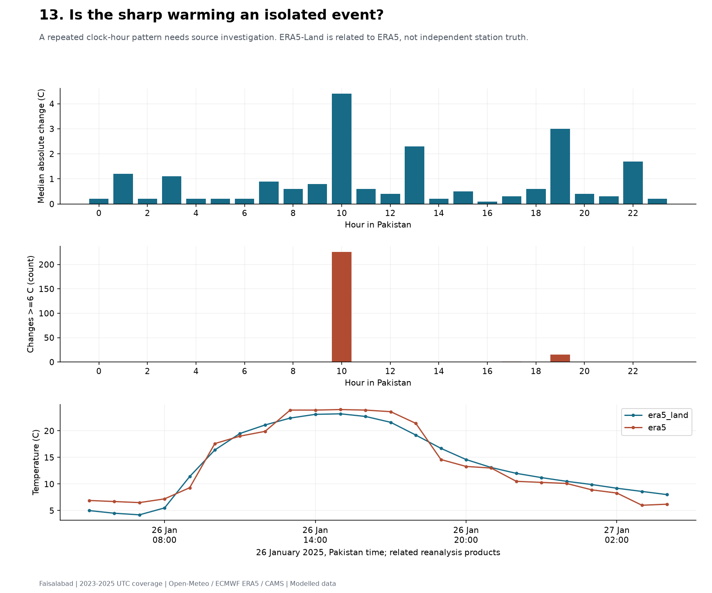

A one-day comparison with ERA5-Land shows temperature rising from **11.4 to 16.4 C** over the corresponding 09:00-10:00 local hour, a 5.0 C change instead of 8.3 C. The products are related and use different grid cells; this is not an independent station check. The repeated timing needs further investigation of product processing and independent observations. Morning warming is plausible, but we cannot attribute the abrupt steps to a confirmed physical mechanism. Radiation and fog were not collected, so sunlight or fog clearing cannot be established as the cause. **Retain, flag, and avoid overconfident interpretation.**

### AQI plateau: inspect changing pollutants

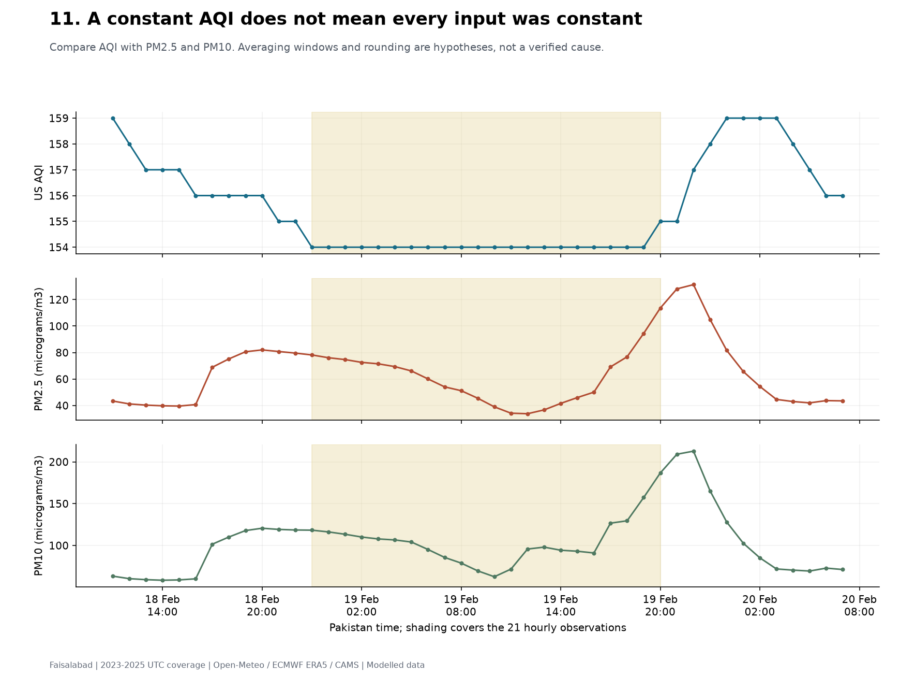

The exact interval and pollutant ranges are recorded in [findings.json](eda/findings.json). The AQI value is 154 for 21 consecutive hourly observations starting at **23:00 local time on 18 February 2024** and ending at **19:00 on 19 February**.

During the plateau, PM2.5 ranges from **33.8 to 94.5 micrograms/m3** and PM10 from **62.6 to 157.4 micrograms/m3**. All 21 complete numeric records are distinct, so this is not a repeated block of entire records.

The provider documents rolling windows for AQI pollutant calculations. Rounding and averaging are plausible reasons for a flat integer index while instantaneous PM changes, but the full AQI calculation has not been reconstructed. We lack other pollutant components and preceding calculation windows in the displayed event window. **Keep the values and leave the cause unresolved.** Do not label this a sensor failure: it is model output.

### Long dry spell and nighttime UV

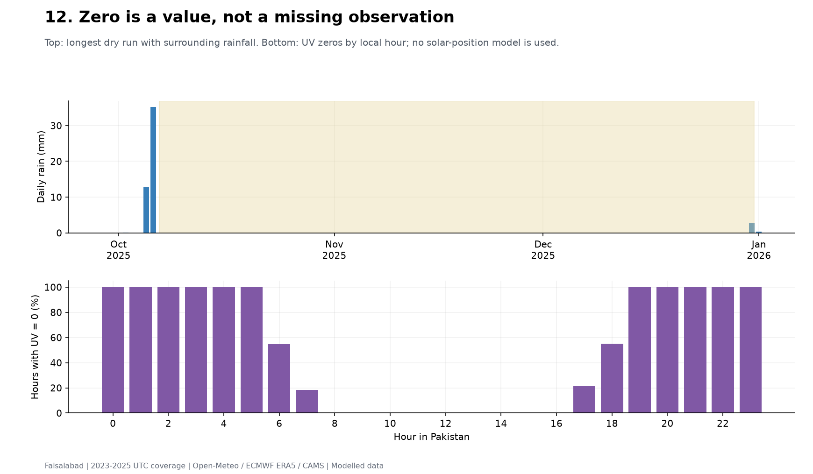

The longest zero-rain run spans **2,051 hourly observations**, from **6 October 2025 at 20:00** to **31 December 2025 at 06:00 Pakistan time**, inclusive. The timeline has no missing timestamps, and other variables change through the dry interval. This is not a full-record collection freeze. That does not independently validate the absence of rain; the length remains a source-comparison question.

No zero-rain or zero-UV observations are recoded as missing. Detailed decisions and open questions are kept separately from the original observations.

## Decisions and open questions

| Finding | Decision or next action |
| --- | --- |
| Complete hourly records and stable units | Continue with Faisalabad |
| No missing historical values | Do not invent imputation; still define future-outage handling |
| Cooling event has aligned rain/humidity/wind changes | Retain |
| Sharp warming repeatedly concentrated at 10:00 local | Retain; investigate source processing, compare related products, and seek independent observations |
| Constant AQI while other source fields vary | Retain; investigate provider calculation and version history |
| Strong dry-hour imbalance | Define event threshold; evaluate rain probabilities and amounts separately |
| Circular direction and calm hours | Use circular representation and a documented calm policy |
| Daily and seasonal structure | Candidate hour, month, lag, and rolling features; validate their usefulness later |
| Modelled historical labels | Do not claim independent local station accuracy |
| Whole history inspected | Reserve a separate, uninspected period for the final test |

No trained models, learned imputation, target shifts, clipping, or outlier removal were introduced. The project still needs historical/live source alignment, feature availability rules, the feature store, three model families, agents, automation, and deployment. The [requirements checklist](REQUIREMENTS.md) tracks these separately.

The general EDA is complete for the current candidate dataset. The unresolved source questions above remain limitations and follow-up work, not silently completed checks.

## Reproduce

```powershell
python -m venv .venv
.\.venv\Scripts\python.exe -m pip install -r requirements-eda.txt
python scripts/check_warming_source.py
.\.venv\Scripts\python.exe scripts/eda_faisalabad.py
.\.venv\Scripts\python.exe scripts/build_eda_notebook.py --execute
.\.venv\Scripts\python.exe -m unittest discover -s tests -v
```

Download the history first using `python scripts/audit_history.py --download` if the local CSV is absent. `requirements-eda.txt` specifies dependency ranges; the Python, pandas, NumPy, and Matplotlib versions used for this run are in `eda/findings.json`. The notebook builder uses a temporary local kernelspec and does not change global Jupyter configuration.

Tables are in `docs/eda/tables/` and figures in `docs/eda/figures/`. Event-window tables are short derived extracts for inspection; the complete source dataset remains local. The EDA can be regenerated without external API calls once the historical data has been downloaded.

Validation for this revision: **17 automated tests passed**, all **14 code cells** executed, and the notebook contains **13 embedded figures**. The input dataset fingerprint remained unchanged. The figures were visually reviewed; heading spacing and the all-zero rainfall panel were corrected before saving the final notebook.

During environment setup, a truncated Pygments download failed its package hash check. A fresh copy was verified against the official PyPI SHA-256 before installation continued. Integrity checking was not disabled.

## Sources and attribution

- [Open-Meteo Historical Weather API](https://open-meteo.com/en/docs/historical-weather-api): ERA5 definitions and historical source properties.
- [Open-Meteo Air Quality API](https://open-meteo.com/en/docs/air-quality-api): CAMS sources, pollutant definitions, and AQI windows.
- [pandas correlation](https://pandas.pydata.org/docs/reference/api/pandas.DataFrame.corr.html) and [autocorrelation](https://pandas.pydata.org/docs/reference/api/pandas.Series.autocorr.html): statistical operations used here.
- Data: Open-Meteo, ECMWF/Copernicus ERA5, and CAMS. Figures and tables are derived from that data. Attribution and access terms are recorded in [DATASET.md](DATASET.md).
